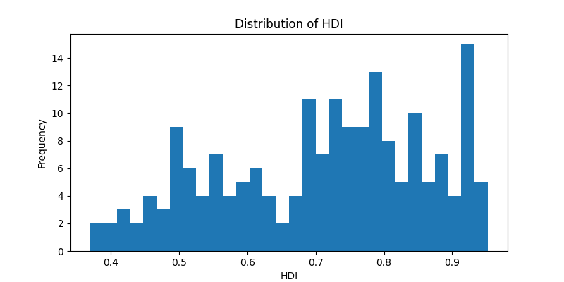

# 🌍 Global Economy Analysis (World Bank + HDI)


**Deployment status:** live preview URL has not been verified.

A **data-driven one-page report** on the state of the global economy using World Bank and UN HDI datasets.  
This project covers the full **ETL pipeline**, schema validation, profiling, and insight generation — preparing data for **Power BI dashboarding**.
It now also includes an **API deployment workflow** with FastAPI + Docker for online access.

---

## 🚀 What’s included

| Folder/File                                     | Description                                                            |
| ----------------------------------------------- | ---------------------------------------------------------------------- |
| `src/data_ingestion.py`                         | Python ETL (Extract + Merge + Save) with **Pandera schema validation** |
| `tests/test_data_ingestion.py`                  | Automated unit tests (pytest) for ingestion & merge                    |
| `notebooks/data_profiling_and_validation.ipynb` | Post-ingestion QA & profiling notebook (skimpy + missing data heatmap) |
| `notebooks/api_deployment.ipynb`                | Deploy processed dataset as REST API with FastAPI                      |
| `data/processed_data.csv`                       | Cleaned dataset produced by ETL pipeline                               |
| `reports/BUILD_PBIX.md`                         | Step-by-step guide + paste-ready DAX for Power BI                      |
| `powerbi/GlobalEconomy.pbix`                    | Final Power BI dashboard                                               |
| `reports/images/`                               | Profiling visualizations & histograms                                  |
| `images/`                                       | Dashboard preview & pipeline diagram                                   |
| `Dockerfile` + `render.yaml`                    | Container & deployment configuration for Render/Railway                |
| `requirements.txt`                              | Reproducible Python environment                                        |

---

## 📂 Dataset Description

| Dataset                     | Source               | Records | Fields | Format |
| --------------------------- | -------------------- | ------- | ------ | ------ |
| **World Bank Indicators**   | World Bank Open Data | 12,657  | 58     | Excel  |
| **Human Development Index** | United Nations       | ~200    | 2      | CSV    |

Key fields used:  
`GDP (USD)`, `GDP per capita (USD)`, `Year`, `Country Code`, `Region`, `Life Expectancy`, `Power Consumption`, `HDI`.

---

## 🔧 Project Pipeline


1. **Extract** → Load multi-sheet Excel + HDI CSV (`src/data_ingestion.py`)
2. **Validate** → Schema check with [Pandera](https://pandera.readthedocs.io)
3. **Transform** → Filter 2014, calculate population, join HDI
4. **Profile** → EDA notebook (skimpy + missing data heatmap)
5. **Load** → Save data`/processed_data.csv`
6. **Visualize** → Build Power BI report using [BUILD_PBIX.md](/reports/BUILD_PBIX.md)
7. **Deploy** → Serve dataset as API (FastAPI + Docker + Render)
8. **Insights** → Correlation analysis + storytelling with bookmarks

---

## ⚙️ Setup & Installation

1. Clone the repo and install dependencies:

```bash
git clone https://github.com/Sohila-Khaled-Abbas/world-economy-bi-project.git
cd world-economy-bi-project

# Install dependencies
pip install -r requirements.txt
```

2. Run ETL:

```bash
python src/data_ingestion.py
```

3. Run tests:

```bash
pytest -v
```

4. Run profiling notebook:

```bash
jupyter notebook 
notebooks/data_profiling_and_validation.ipynb
```

---

## 🛠 Building the Power BI Dashboard

Follow [BUILD_PBIX.md](/reports/BUILD_PBIX.md) for **click-by-click** **instructions** & paste-ready DAX.

- Standardize column names in Power Query
- Create measures: `TotalGDP`, `TotalPopulationM`, `Avg_HDI`, `Corr_GDPpc_HDI_2014`
- Build visuals: Stacked area GDP & population, Bubble chart (Life vs GDPpc), HDI bar chart, Power vs GDP scatter
- Add bookmarks for storytelling & tooltip pages for country drill-through

---

## 🌐 Deploy as REST API

1. **Local Run**:

```bash
uvicorn main:app --reload
```

Visit:

- `http://127.0.0.1:8000` → Welcome message
- `http://127.0.0.1:8000/docs` → Interactive API docs

2. **Docker Build & Run**:

```bash
docker build -t global-economy-api .
docker run -p 8000:8000 global-economy-api
```

3. **Deploy to Render/Railway**:
Push repo → Render detects `render.yaml` → auto-deploy → get public API URL.

---

## 📊 Key Insights (2014)

| Metric                              | Insight                                   |
| ----------------------------------- | ----------------------------------------- |
| Correlation (GDP per Capita vs HDI) | **0.85** (Strong positive correlation)    |
| Population Distribution             | Asia & Africa account for most population |
| HDI Ranking                         | Europe highest, Africa lowest             |

### Sample histograms

_hist.png)
_hist.png)

_hist.png)

---

## 📷 Preview

See more charts in `reports/images/`.

---

## 🧪 Testing & QA

 **Unit tests** in `tests/test_data_ingestion.py` check:

- Excel sheet combination
- CSV load
- Left-join correctness on Country Code

**Schema validation** ensures key columns exist (Country Code, GDP, GDP per Capita)

**Profiling notebook** generates:

- Summary stats
- Missing value heatmap
- Key distribution histograms

---

## 🔄 CI/CD Pipeline

This repo uses **GitHub Actions** for continuous integration & deployment:

- ✅ Runs pytest for ingestion validation
- 🐳 Builds Docker container
- 🚀 Deploys to Render automatically on push to `main`

To enable:

- Add your Render deploy hook as a GitHub Secret: `RENDER_DEPLOY_HOOK`
- Push changes to `main` branch → pipeline auto-runs

---

## 🔑 Environment Variables

- Create a `.env` file in the project root:

```dotenv
APP_NAME=Global Economy API
APP_VERSION=1.0
HOST=0.0.0.0
PORT=8000
DATA_FILE=data/processed_data.csv
```

- Load with `python-dotenv` (already installed via requirements.txt).

---

## 🧭 Roadmap

- Automate ETL with Prefect/Airflow + GitHub Actions
- Deploy interactive Power BI report to Power BI Service
- Publish API docs + interactive notebook on GitHub Pages
- Add education, inequality, and climate indicators

---

## 📜 License

This project is licensed under the [MIT License](/LICENSE) — feel free to use and adapt it.

---

## 👩‍💻 Author

**Sohila Khaled Galal Abbas**
*Data Analyst & Power BI Developer*
🔗 [LinkedIn](www.linkedin.com/in/sohilakabbas) • [GitHub](https://github.com/Sohila-Khaled-Abbas)


## Environment and clean working tree

The tracked `.env` previously contained non-secret application defaults, not a credential. These can be placed in a local, ignored `.env` as needed; use the committed [example](.env.example). Python bytecode and test caches should never be committed. The existing history retains previously published files; this maintenance PR only cleans the current branch.
